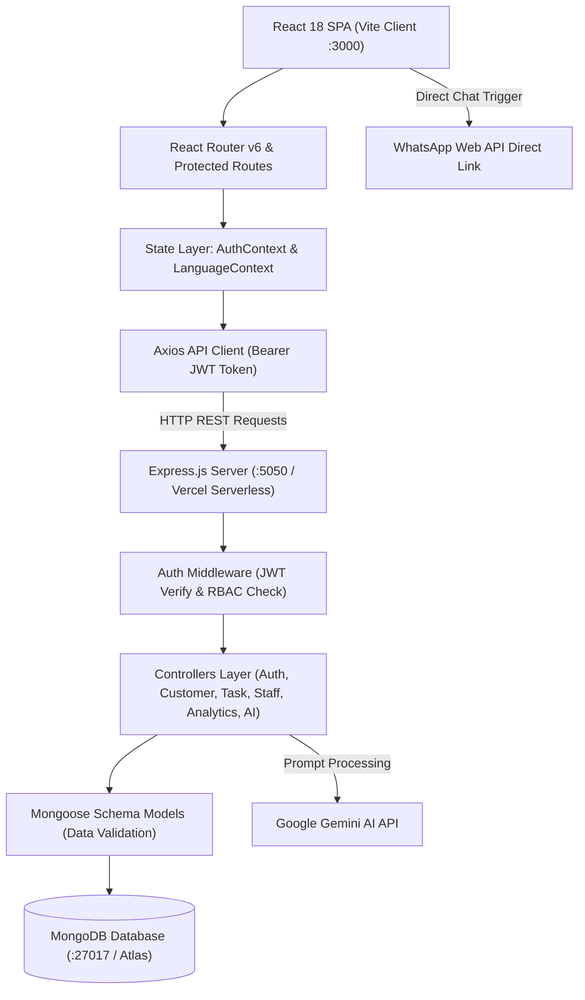

# ACADEMIC PROJECT REPORT FOR UMS SUBMISSION

---

# **PROJECT REPORT**
## **VeltrixCRM: Modern Full-Stack Enterprise Customer Relationship Management & Operations Platform**

---

### **Project & Submission Details**
* **Project Title:** VeltrixCRM (Enterprise Edition)
* **Student Name:** Phaniswar Janyavula
* **Contact Email:** phaniswarjanyavula@gmail.com
* **Project GitHub Repository Link:** [https://github.com/phaniswar23/VeltrixCRM](https://github.com/phaniswar23/VeltrixCRM)
* **Technology Stack:** MERN Stack (MongoDB, Express.js, React 18, Node.js), Vite, Tailwind CSS, GSAP, Chart.js, JWT, Google Gemini AI
* **Submission Platform:** University Management System (UMS)
* **Academic Term:** Capstone / Term Project Submission (2025–2026)

---

## **TABLE OF CONTENTS**
1. [Executive Summary / Abstract](#1-executive-summary--abstract)
2. [Introduction & Problem Statement](#2-introduction--problem-statement)
3. [Project Objectives](#3-project-objectives)
4. [Technology Stack & System Architecture](#4-technology-stack--system-architecture)
5. [Database Schema & Data Models](#5-database-schema--data-models)
6. [Detailed Modules & Features Implemented (What Has Been Done)](#6-detailed-modules--features-implemented-what-has-been-done)
   - 6.1 Authentication & Role-Based Access Control (RBAC)
   - 6.2 Customer Pipeline & Direct WhatsApp Messaging
   - 6.3 Task Management & Velocity Tracking
   - 6.4 Staff & Personnel Administration
   - 6.5 Interactive Business Analytics & Data Export (CSV)
   - 6.6 Veltrix AI Assistant (Gemini LLM Integration)
   - 6.7 Multilingual Localization Engine (English, Telugu, Hindi, Punjabi)
   - 6.8 High-Performance Landing Page with GSAP Animations & Pricing
7. [RESTful API Architecture & Endpoints](#7-restful-api-architecture--endpoints)
8. [Security & Performance Implementation](#8-security--performance-implementation)
9. [Project Links, Setup & Deployment Guide](#9-project-links-setup--deployment-guide)
10. [Testing & Quality Assurance](#10-testing--quality-assurance)
11. [Conclusion & Future Enhancements](#11-conclusion--future-enhancements)
12. [Student Declaration](#12-student-declaration)

---

## **1. EXECUTIVE SUMMARY / ABSTRACT**

Modern enterprise operations require rapid customer communication, granular staff delegation, transparent sales pipelines, and intelligent decision-making. Conventional CRM solutions are frequently bloated, expensive, difficult to configure, and lack real-time localization and intuitive AI-driven operations.

**VeltrixCRM** is a modern, high-performance, full-stack Customer Relationship Management (CRM) and operational workflow platform developed using the **MERN Stack** (MongoDB, Express.js, React 18 with Vite, and Node.js). The application bridges the gap between customer relationship tracking and operational task management by incorporating:
- **Role-Based Access Control (RBAC)** distinguishing between Administrative executives and Staff operational personnel.
- **Dynamic Customer Lifecycle Management** (Leads, Active Clients, Inactive Accounts) with direct **WhatsApp Web integration** for one-click communication.
- **Task Velocity & Delegation Engine** connecting team members to customer deliverables.
- **Interactive Business Intelligence Dashboards** visualizing stage distributions, team workload, and real-time activity audit trails with one-click **CSV data exports**.
- **Veltrix AI Assistant**, an intelligent conversational widget powered by the **Google Gemini API** with an embedded fallback knowledge base for instant platform assistance.
- **Multilingual Support (i18n)** providing seamless live UI language switching across **English, Telugu, Hindi, and Punjabi**.

The project delivers an enterprise-grade, responsive, and visually appealing web application conforming to modern industry standards.

---

## **2. INTRODUCTION & PROBLEM STATEMENT**

### **2.1 Background**
Managing business-to-customer relationships and team deliverables across spreadsheets or fragmented chat channels leads to operational bottlenecks, missed sales follow-ups, opaque staff accountability, and lost revenue.

### **2.2 Problem Statement**
Small-to-medium enterprises (SMEs) and growing teams encounter several persistent challenges:
1. **Lead Leakage & Fragmented Communication:** Inquiries received through contact forms or cold outreach are frequently misplaced due to the absence of a unified database.
2. **Lack of Operational Visibility:** Managers struggle to monitor which team members are handling specific accounts and the status of related deliverables.
3. **Delayed Customer Engagement:** Traditional email follow-ups suffer from low open rates; businesses lack direct, frictionless channels like instant messaging (WhatsApp) integrated directly into customer records.
4. **Data Silos & Reporting Friction:** Generating performance reports and exporting records requires manual spreadsheet compilation.
5. **Language Barriers in Regional Operations:** Most global enterprise CRMs offer English-only interfaces, presenting steep learning curves for multilingual Indian and regional teams.

### **2.3 The VeltrixCRM Solution**
VeltrixCRM solves these problems by providing an integrated, cloud-native CRM platform that combines customer lifecycle management, staff delegation, automated audit logging, visual analytics, AI-assisted navigation, and regional language accessibility.

---

## **3. PROJECT OBJECTIVES**

The primary objectives achieved in this project include:
1. **Develop a Scalable Full-Stack Architecture:** Construct a decoupled REST API using Express.js and Node.js connected to a flexible MongoDB document database, paired with a React 18 single-page application (SPA).
2. **Implement Secure Multi-Role Authentication:** Integrate JSON Web Tokens (JWT) and salted Bcrypt password hashing to strictly isolate Admin capabilities (staff management, full system analytics, data export) from Staff roles (assigned customers and operational tasks).
3. **Build an Intuitive Customer Management System (CRUD):** Enable instant creation, updating, assignment, and status filtering of leads and customers.
4. **Enable Instant Direct Communication:** Connect customer phone records directly with the WhatsApp Web API to facilitate immediate outreach with pre-formatted messages.
5. **Provide Real-Time Operational Analytics:** Present visual metrics using Chart.js depicting lead conversion stages, task completion rates, staff workload, and system pulse logs.
6. **Implement Contextual AI Support:** Embed an autonomous AI assistant capable of guiding users through platform navigation, pricing tiers, and CRM best practices.
7. **Deliver Regional Localization:** Build a dynamic translation context supporting English, Telugu, Hindi, and Punjabi without page reloads.

---

## **4. TECHNOLOGY STACK & SYSTEM ARCHITECTURE**

### **4.1 Technology Stack Matrix**

| Layer | Technology | Purpose & Rationale |
|---|---|---|
| **Frontend Framework** | **React 18** (`.jsx`) | Component-driven declarative UI with hooks and Context API |
| **Build Tool** | **Vite 6** | Lightning-fast Hot Module Replacement (HMR) and optimized production bundling |
| **Styling & Design System** | **Tailwind CSS & Custom Tokens** | Premium editorial design system (`#2D3A2D` Forest Green, `#9B5A46` Terracotta, `#FBFBF9` Natural Base) |
| **Animations & FX** | **GSAP 3, Lenis, Canvas Confetti** | Physics-based kinetic hero card spread/fold animations, smooth scrolling, checkout celebration |
| **Icons & Visualization** | **Lucide React & Chart.js** | Consistent icon set and responsive canvas charts (react-chartjs-2) |
| **Backend Framework** | **Node.js & Express.js** | Event-driven, non-blocking asynchronous RESTful API server |
| **Database & ODM** | **MongoDB & Mongoose 8** | Document-oriented NoSQL database with strict schema validation and population |
| **Authentication** | **JWT & Bcrypt.js** | Stateless token-based security and salted password encryption |
| **Artificial Intelligence** | **Google Gemini API** | Real-time generative AI conversational assistance with smart domain fallback |
| **HTTP Client** | **Axios** | Promised-based HTTP client with request/response interceptors for auth headers |

---

### **4.2 System Architecture Diagram**



---

### **4.3 Directory Structure**

```
VeltrixCRM/
├── server/
│   ├── config/
│   │   └── db.js                 # MongoDB Mongoose connection handler
│   ├── models/                   # Mongoose Schemas & Data Models
│   │   ├── User.js               # User accounts (Admin / Staff)
│   │   ├── Customer.js           # Leads and customer records
│   │   ├── Task.js               # Delegated operational tasks
│   │   ├── ActivityLog.js        # Audit trail of system events
│   │   ├── Notification.js       # User notification records
│   │   └── ContactMessage.js     # Public landing page contact inquiries
│   ├── controllers/              # Business Logic & Request Handlers
│   │   ├── authController.js     # Register, Login, Profile, Forgot Password
│   │   ├── customerController.js # Customer CRUD, status, staff assignment
│   │   ├── taskController.js     # Task CRUD, status workflow, priority
│   │   ├── staffController.js    # Personnel management, workload counts
│   │   ├── analyticsController.js# Aggregations, velocity, CSV exporter
│   │   ├── aiController.js       # Gemini API bridge with intelligent fallback
│   │   └── contactController.js  # Contact inquiry submission handler
│   ├── middleware/
│   │   └── authMiddleware.js     # JWT token verification & role authorization
│   ├── routes/                   # Modular Express route declarations
│   ├── seed/
│   │   └── seed.js               # Database seeder with realistic demo data
│   └── index.js                  # Express backend entry point
├── client/
│   ├── public/                   # Static assets, logos, favicon
│   └── src/
│       ├── components/           # Reusable UI components (Sidebar, Topbar, Modals, AI Widget)
│       ├── context/              # AuthContext (JWT/User) & LanguageContext (i18n)
│       ├── pages/                # Page views (Admin/Staff Dashboards, Customers, Tasks, Analytics, etc.)
│       ├── services/             # Axios API service instance
│       ├── translations/         # Multilingual dictionaries (en, te, hi, pa)
│       ├── App.jsx               # Route orchestrator & Protected Layouts
│       └── main.jsx              # React DOM mounting point
├── package.json                  # Unified root automation scripts
├── vercel.json                   # Cloud serverless deployment configuration
└── .env                          # Environment configurations
```

---

## **5. DATABASE SCHEMA & DATA MODELS**

The application uses **MongoDB** managed via **Mongoose ODM**. Below are the primary data models:

### **5.1 User Schema (`User.js`)**
Represents platform administrators and staff personnel:
- `name` (String, required): Full name of the user.
- `email` (String, required, unique, lowercase): Login credential.
- `password` (String, required, hashed via `bcryptjs`).
- `role` (String, enum: `['admin', 'staff']`, default: `'staff'`).
- `business_type` (String): Department or business specialization.
- `avatar` (String): Profile image URL.
- `resetPasswordOtp` (String): Verification code for password recovery.
- `resetPasswordExpires` (Date): OTP expiration timestamp.
- `last_activity` (Date): Records active session timestamps.

### **5.2 Customer Schema (`Customer.js`)**
Tracks all prospective leads and active clientele:
- `name` (String, required): Company or contact name.
- `email` (String): Customer contact email.
- `phone` (String): Customer phone number formatted for direct calling or WhatsApp.
- `status` (String, enum: `['lead', 'active', 'inactive']`, default: `'lead'`).
- `assigned_to` (ObjectId, ref: `'User'`): Team member responsible for account management.
- `timestamps`: Automatically manages `createdAt` and `updatedAt`.

### **5.3 Task Schema (`Task.js`)**
Handles daily operational deliverables:
- `title` (String, required): Deliverable heading.
- `description` (String): Detailed instructions or notes.
- `assigned_to` (ObjectId, ref: `'User'`, required): Staff member delegated to the task.
- `customer_id` (ObjectId, ref: `'Customer'`): Associated client account.
- `status` (String, enum: `['pending', 'in_progress', 'completed']`, default: `'pending'`).
- `due_date` (Date): Target deadline.

### **5.4 Activity Log Schema (`ActivityLog.js`)**
Provides immutable enterprise audit logging:
- `user_id` (ObjectId, ref: `'User'`): User who executed the action.
- `action` (String, required): Short action tag (e.g., `"CUSTOMER_CREATED"`, `"TASK_UPDATED"`).
- `description` (String): Human-readable summary of the event.
- `timestamps`: Precise occurrence timestamp.

### **5.5 Notification Schema (`Notification.js`)**
Manages real-time in-app alerts:
- `user_id` (ObjectId, ref: `'User'`): Recipient user.
- `title` (String, required): Notification headline.
- `message` (String, required): Notification message body.
- `is_read` (Boolean, default: `false`): Read/unread flag.

---

## **6. DETAILED MODULES & FEATURES IMPLEMENTED (WHAT HAS BEEN DONE)**

### **6.1 Authentication & Role-Based Access Control (RBAC)**
* **Secure Registration & Login:** Users register with encrypted passwords (`bcryptjs` salt rounds: 10). Authentication issues signed JSON Web Tokens (JWT) stored client-side for authenticated API requests.
* **Granular Route Protection:** Custom React component `<ProtectedRoute requireRole="admin">` intercepts navigation. Unauthorized attempts are redirected immediately to appropriate dashboards.
* **Password Recovery Flow:** Implemented an OTP-based password reset module allowing users to recover credentials safely with time-limited tokens.
* **Persistent Sessions:** User state and active tokens persist securely in `localStorage` through `AuthContext`.

### **6.2 Customer Lifecycle & WhatsApp Direct Communication**
* **Comprehensive CRUD Operations:** Add, view, edit, and archive customers with modal interfaces.
* **Pipeline Filtering:** Quick filtering by status (`All`, `Leads`, `Active Clients`, `Inactive Accounts`) and search by name, email, or telephone number.
* **Direct WhatsApp Integration:** Clicking the WhatsApp action icon automatically formats the customer's phone number and opens a direct WhatsApp Web chat window (`https://wa.me/<phone>`), eliminating manual contact saving and speeding up outreach.
* **Staff Assignment:** Administrators can assign and reassign customers to specific staff members with live updates.

### **6.3 Task Management & Velocity Tracking**
* **Workplace Delegation:** Create operational tasks linked directly to a client and assigned to a designated staff member.
* **Status Progression Pipeline:** Tasks move seamlessly through `Pending`, `In Progress`, and `Completed` stages.
* **Priority Tagging & Deadline Alerts:** Tasks display due dates and priority indicators (`High`, `Medium`, `Low`), enabling staff to prioritize urgent deliverables.

### **6.4 Staff & Personnel Administration**
* **Admin-Exclusive Command Center:** Only administrators can view the complete staff roster, add new personnel, update business roles, and inspect workload statistics.
* **Live Staff Workload Metrics:** Automatically calculates and displays the number of active customers and assigned tasks per staff member, preventing resource bottlenecks.

### **6.5 Interactive Business Analytics & Data Export (CSV)**
* **Visual Data Charts:** Built with `Chart.js` and `react-chartjs-2` to display:
  - **Entity Distribution Doughnut Chart:** Breakdown of Leads vs. Active vs. Inactive clients.
  - **Task Velocity Bar Chart:** Operational completion velocity (Pending vs. In Progress vs. Completed).
  - **Staff Workload Comparison:** Cross-team workload distribution.
* **Audit Trail (System Pulse):** Real-time activity log stream documenting all updates across customers, tasks, and users.
* **One-Click CSV Export:** Server-side streaming endpoint (`/api/analytics/export/csv`) formats and downloads complete customer databases as CSV files for offline analysis and board presentations.

### **6.6 Veltrix AI Assistant (Gemini LLM Integration)**
* **Floating AI Chat Widget:** Omnipresent assistant accessible across all CRM dashboard views.
* **Dual-Engine Response Pipeline:** Integrates the Google Gemini API for intelligent, contextual conversation. If an API key is unconfigured or rate-limited, an intelligent built-in domain fallback engine seamlessly answers questions regarding platform navigation, founder information, pricing, leads, tasks, and analytics.

### **6.7 Multilingual Localization Engine (i18n)**
* **Four Supported Languages:** **English (EN)**, **Telugu (TE)**, **Hindi (HI)**, and **Punjabi (PA)**.
* **Instant Dynamic Switching:** Driven by React `LanguageContext` and dedicated translation dictionaries (`client/src/translations/`), switching languages updates navigation, forms, table headers, and status badges instantly without re-rendering or reloading the page.

### **6.8 High-Performance Landing Page & Pricing Engine**
* **Kinetic Hero Animation:** Features a physics-based GSAP 3 animation with interactive 1-by-2-by-3 card spread and fold transitions.
* **Smooth Scrolling:** Powered by `@studio-freight/lenis` for smooth momentum-based navigation.
* **Interactive Pricing & Checkout Modal:** Tiered subscription plans (Starter ₹0, Professional ₹999/mo, Enterprise ₹2999/mo) with simulated card checkout and canvas confetti celebration effects.
* **Contact Inquiries Form:** Direct database capture of visitor messages into the `ContactMessage` collection.

---

## **7. RESTFUL API ARCHITECTURE & ENDPOINTS**

The server exposes a cleanly structured REST API under the `/api` prefix:

### **Authentication (`/api/auth`)**
| Method | Endpoint | Access | Description |
|---|---|---|---|
| `POST` | `/api/auth/register` | Public | Register a new user |
| `POST` | `/api/auth/login` | Public | Authenticate user and return JWT |
| `GET` | `/api/auth/me` | Authenticated | Retrieve authenticated user profile |
| `POST` | `/api/auth/forgot-password` | Public | Request OTP for password recovery |
| `POST` | `/api/auth/reset-password` | Public | Reset password with valid OTP |

### **Customer Management (`/api/customers`)**
| Method | Endpoint | Access | Description |
|---|---|---|---|
| `GET` | `/api/customers` | Authenticated | Fetch customers with search, status, & staff filters |
| `GET` | `/api/customers/:id` | Authenticated | Get detailed customer record |
| `POST` | `/api/customers` | Authenticated | Create a new customer or lead |
| `PUT` | `/api/customers/:id` | Authenticated | Update customer details or status |
| `DELETE` | `/api/customers/:id` | Admin Only | Delete a customer record |

### **Task Operations (`/api/tasks`)**
| Method | Endpoint | Access | Description |
|---|---|---|---|
| `GET` | `/api/tasks` | Authenticated | Fetch tasks (filterable by status & staff) |
| `GET` | `/api/tasks/:id` | Authenticated | Fetch single task details |
| `POST` | `/api/tasks` | Authenticated | Create and delegate a task |
| `PUT` | `/api/tasks/:id` | Authenticated | Update task status, description, or due date |
| `DELETE` | `/api/tasks/:id` | Authenticated | Remove a task |

### **Staff Administration (`/api/staff`)**
| Method | Endpoint | Access | Description |
|---|---|---|---|
| `GET` | `/api/staff` | Authenticated | Retrieve staff directory with aggregated customer & task counts |
| `GET` | `/api/staff/all-users` | Admin Only | List all users across the platform |
| `GET` | `/api/staff/stats` | Admin Only | High-level summary metrics for executive dashboard |
| `GET` | `/api/staff/:id` | Admin Only | View detailed staff member profile |
| `POST` | `/api/staff` | Admin Only | Create a new staff account |
| `PUT` | `/api/staff/:id` | Admin Only | Update staff details or role |
| `DELETE` | `/api/staff/:id` | Admin Only | Remove staff member |

### **Analytics & System (`/api/analytics`, `/api/ai`, `/api/contact`)**
| Method | Endpoint | Access | Description |
|---|---|---|---|
| `GET` | `/api/analytics` | Authenticated | Aggregate statistics for charts & audit logs |
| `GET` | `/api/analytics/export/csv` | Authenticated | Download customer records as CSV |
| `POST` | `/api/ai/chat` | Authenticated | Process conversational AI query via Gemini/Fallback |
| `POST` | `/api/contact` | Public | Submit landing page contact inquiry |

---

## **8. SECURITY & PERFORMANCE IMPLEMENTATION**

1. **Password Hashing:** Passwords are never stored in plaintext. They are salted and hashed using `bcryptjs` with a cost factor of 10 prior to document insertion.
2. **Stateless JWT Tokens:** Authentication tokens are digitally signed with a server-side secret (`JWT_SECRET`) and validated on each incoming protected request via Express middleware.
3. **Data Sanitization:** Mongoose model instances strip sensitive fields (`password`, `resetPasswordOtp`, `resetPasswordExpires`) in their `toJSON` serialization method, ensuring credentials never leak in API responses.
4. **Role-Based Authorization Middleware:** Sensitive administrative endpoints enforce an `adminOnly` guard that checks `req.user.role === 'admin'`, returning HTTP 403 Forbidden for unauthorized requests.
5. **CORS Security:** Enabled CORS configuration preventing unauthorized cross-origin requests.
6. **Optimized Queries & Population:** Relational lookups use Mongoose `.populate()` with explicit field selections, minimizing memory overhead and database transfer size.

---

## **9. PROJECT LINKS, SETUP & DEPLOYMENT GUIDE**

### **9.1 Official Project Links**
* **GitHub Repository URL:** [https://github.com/phaniswar23/VeltrixCRM](https://github.com/phaniswar23/VeltrixCRM)
* **Author / Developer:** Phaniswar Janyavula ([GitHub: @phaniswar23](https://github.com/phaniswar23))

---

### **9.2 Local Development Setup**

#### **Step 1: Clone the Repository**
```bash
git clone https://github.com/phaniswar23/VeltrixCRM.git
cd VeltrixCRM
```

#### **Step 2: Environment Configuration**
Create a `.env` file in the project root directory:
```env
PORT=5050
MONGO_URI=mongodb://127.0.0.1:27017/veltrixcrm
JWT_SECRET=veltrix_crm_super_secure_jwt_secret_key_2026
GEMINI_API_KEY=your_optional_gemini_api_key
```

#### **Step 3: Install Dependencies**
```bash
# Install root dependencies
npm install

# Install client dependencies
cd client && npm install && cd ..
```

#### **Step 4: Seed Database with Demo Records**
```bash
npm run seed
```
*This populates MongoDB with initial Admin, Staff, Leads/Customers, Tasks, and Activity Logs.*

#### **Step 5: Run Application Concurrently**
```bash
npm run dev
```
* **Frontend:** Accessible at `http://localhost:3000`
* **Backend API:** Running at `http://localhost:5050`

---

### **9.3 Pre-configured Demo Credentials**

| Role | Email Address | Password | Permissions |
|---|---|---|---|
| **System Administrator** | `admin@veltrix.com` | `password123` | Full access (Staff management, system analytics, all leads, CSV export, task delegation) |
| **Operational Staff** | `staff@veltrix.com` | `password123` | Operational access (Assigned customers, task execution, WhatsApp outreach, profile) |

---

### **9.4 Cloud Deployment (Vercel)**
The application contains a root `vercel.json` configured with rewrite routing to support serverless deployment:
1. Connect GitHub repository `https://github.com/phaniswar23/VeltrixCRM` to Vercel.
2. Configure Environment Variables in Vercel Dashboard:
   - `MONGO_URI`: MongoDB Atlas connection string.
   - `JWT_SECRET`: Production secret string.
   - `GEMINI_API_KEY`: *(Optional)* Google Gemini API key.
3. Deploy directly with continuous integration from the `main` branch.

---

## **10. TESTING & QUALITY ASSURANCE**

The platform underwent comprehensive functional and security testing:

1. **Authentication Testing:** Validated registration, login with correct/incorrect credentials, token expiration, and role verification.
2. **Access Control (RBAC) Testing:** Verified that non-admin staff users attempting to access `/admin/staff` or administrative API endpoints receive HTTP 403 Forbidden and are redirected.
3. **CRUD Data Integrity:** Verified that creating, modifying, and deleting customers and tasks correctly cascades updates to the `ActivityLog` collection.
4. **Direct Messaging Verification:** Tested WhatsApp deep links to ensure telephone numbers format correctly across international and domestic standards.
5. **Cross-Browser & Responsiveness:** Verified responsive layout across desktop displays, tablets, and mobile smartphones.
6. **Localization Verification:** Verified all four language dictionaries (English, Telugu, Hindi, Punjabi) update UI text without missing keys or layout shifts.

---

## **11. CONCLUSION & FUTURE ENHANCEMENTS**

### **11.1 Conclusion**
VeltrixCRM demonstrates a complete, production-ready implementation of a modern MERN stack Customer Relationship Management system. By combining secure role-based access control, real-time analytics, direct messaging integration, an AI-powered virtual assistant, and regional language localization, the platform addresses the operational requirements of modern growing businesses.

### **11.2 Future Enhancements**
1. **Automated Email Workflows:** Integration with SendGrid or AWS SES for automated customer onboarding sequences and deadline reminder emails.
2. **Payment Gateway Integration:** Live payment gateway webhooks (Stripe / Razorpay) for automated subscription upgrades.
3. **WebSockets (Socket.io):** Real-time push notifications for task assignments and live customer updates without manual page refreshes.
4. **Mobile Application:** Building a cross-platform React Native companion app for on-the-field sales representatives.

---

## **12. STUDENT DECLARATION**

I hereby declare that this project report entitled **"VeltrixCRM: Modern Full-Stack Enterprise Customer Relationship Management & Operations Platform"** submitted for evaluation on the **University Management System (UMS)** is an authentic record of original work carried out by me under academic guidelines.

* **Student Name:** Phaniswar Janyavula
* **GitHub Profile:** [https://github.com/phaniswar23](https://github.com/phaniswar23)
* **Project Repository:** [https://github.com/phaniswar23/VeltrixCRM](https://github.com/phaniswar23/VeltrixCRM)
* **Date:** October 19, 2026
